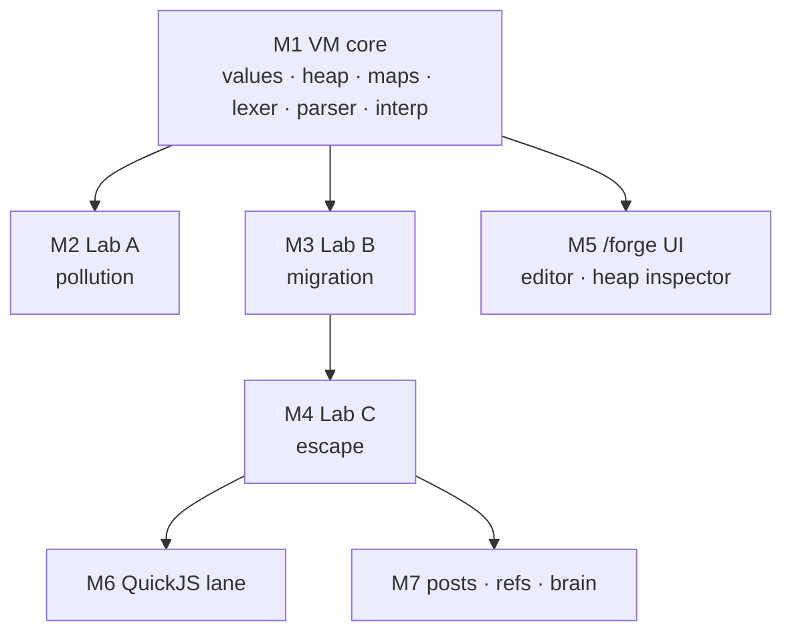

# The Forge — plan

One artifact, four lanes: a micro JavaScript VM we write, three labs that exploit it for real,
a real-engine lane that shows an actual engine's internals, and the writing that ties them to
the 2026 state of the art.

Status: M1, M2, M5 and the first half of M6 shipped on branch `forge` (2026-11-17). M3, M4 and
M7 remain. Work on a branch; the site deploys to Cloudflare Workers with `npm run deploy`, and
pushing `main` deploys nothing.

| Milestone | State | Where |
|---|---|---|
| M1 VM core | done | `src/lib/forge/` — values, heap, maps, interp; 13 tests |
| M2 Lab A | done | `builtins.js` (BUG-2), `host.js`, `labs/pollution.js`; 5 tests |
| M3 Lab B | not started | the bug is planted and tested; the lab and checker are missing |
| M4 Lab C | not started | `allocView` and `read` exist; the escape lab is missing |
| M5 `/forge` UI | done | `src/app/forge/`; verified in a browser |
| M6 QuickJS lane | done | `/forge/quickjs`; verified in a browser, interrupt at 2 s |
| M7 content | not started | posts, ref-radar suggestions |

---

## 0. What each lane proves

| Lane | Artifact | What a reviewer sees |
|---|---|---|
| 1. Micro-VM | `src/lib/forge/` — lexer, parser, heap, interpreter | You can build an engine, not just use one |
| 2. Dojo | Three labs against that VM | You understand the 2026 bug classes down to the byte |
| 3. Real engine | `/forge/quickjs` — QuickJS in WASM, instrumented | You know where the model stops matching the real thing |
| 4. Content | Two posts, ref-radar entries, brain note | You can teach it without spoiling it |

The load-bearing claim: **the labs exploit a machine we wrote**, so the corruption is real
within its memory model. A checker that greps your exploit source would be a quiz; this isn't.

---

## 1. Constraints

- **No `eval`/`new Function` on the Worker.** All guest execution is client-side. Verified:
  workerd rejects dynamic code generation.
- **Every page stays prerendered.** `/forge` is a static shell plus a client island, like `/you`.
- **No real shell, file system or network from guest code.** Same rule as `familiar`. The
  boundary is simulated: the guest sees a fake host with a flag handle.
- **The host JavaScript must never consume guest-controlled strings as JS keys.** Guest data
  lives only inside the `Uint8Array` cage; the host reaches it through offsets. This is the
  property that keeps a guest from polluting the real page.
- **Bundle sanity.** The VM ships to the browser. Target under 40 KiB minified for lane 1;
  lane 3 lazy-loads its WASM only when opened.
- Cloudflare serves static assets up to 25 MiB each, so the QuickJS blob is not a limit
  problem; the browser's willingness to parse it is.

---

## 2. File layout

```
src/lib/forge/
  values.js      tagging: Smi / pointer words, f32/f64 <-> bytes
  heap.js        the cage: bump allocator, headers, mark-sweep, bounds
  maps.js        map table and property layouts (smi | double | tagged | elem)
  lexer.js       tokens
  parser.js      AST (Pratt for expressions)
  interp.js      tree-walker; every runtime value is a u32 word
  builtins.js    Object, Array, String, Math, print
  host.js        the simulated outside: handle table, flag, spawn, fs
  labs/
    pollution.js
    migration.js
    escape.js
  index.js       createForge() public API
  *.test.mjs     node --test, colocated
src/app/forge/
  page.js        static shell (force-static) + metadata
  Forge.js       'use client': editor, run, heap inspector, lab list
src/app/forge/quickjs/
  page.js        lane 3 shell
  QuickJS.js     dynamic import of the wasm runtime
public/forge/    wasm + emscripten glue for lane 3 (lazy)
```

Public API — the contract every slice codes against:

```js
createForge({ heapBytes = 1 << 20, parse, steps })
  .exec(ast)           // -> { ok, value, steps, error, log }; no parser needed
  .run(src)            // -> same shape, compiled through the injected parse()
  .snapshot()          // -> Uint8Array copy of the cage (for the inspector)
  .inspect(word)       // -> { tag: 'smi' | 'ptr', value, mapId?, kind, size? }
  .objects()           // -> [{ offset, mapId, size, mark }] live heap walk
  .labs()              // -> [{ id, title, brief, start, check }]
```

`parse` is injected rather than imported so this module never depends on the parser's file
landing first: the page passes `parse` from `src/lib/forge/parser.js`, tests pass an AST.

Every lab matches that shape; `check` receives the live forge and returns
`{ solved, why }` from **heap state**, never from the guest's source text.

---

## 3. The memory model (load-bearing — do not drift)

This section is the spec. If a slice needs something it doesn't describe, change this file
first.

**Cage.** One `Uint8Array` of `heapBytes`. Every guest reference is an offset into it, so there
is no address space to leak outside the cage — that is the model's whole point, and lane 3
shows what a real engine adds on top.

**Word.** `u32`.
- low bit `0` → Smi, value = `word >>> 1` (31-bit two's complement).
- low bit `1` → pointer, offset = `word & ~1`.

**Object header, 16 bytes.**

| off | field | meaning |
|---|---|---|
| +0 | `mapId` u32 | index into the map table |
| +4 | `size` u32 | bytes including header |
| +8 | `mark` u32 | GC mark |
| +12 | `elem` u32 | pointer word to an elements block, or 0 |

**Slots are 4 bytes.** Smis and tagged pointers sit inline. Doubles do **not**: a `double`
property holds a pointer to an 8-byte HeapNumber allocation, exactly like V8. This is why the
migration bug exists.

**Maps** live host-side in a null-prototype table, never in the cage:

```js
{ id, kind: 'object'|'array'|'string'|'func'|'view',
  props: [{ key, rep: 'smi'|'double'|'tagged' }],
  elemRep: 'smi'|'double'|'tagged' }
```

`key` strings are host strings from the parser only; a guest cannot synthesize a map key,
because property access resolves to a slot index at parse time where possible and through a
linear compare otherwise.

**Allocator.** Bump from `0x1000`, 8-byte aligned. `alloc(bytes, mapId)` returns an offset
word. Mark-sweep compacts nothing (non-moving), so a stale offset stays a valid read of freed
bytes — that is what makes the migration bug teachable instead of a crash.

**Host handles.** `host.js` keeps a JS array of `{ kind: 'flag'|'file'|'exec', value }`.
Guest-visible objects of kind `view` store a handle index in a slot. The table is the sandbox
boundary: retargeting a view's index is the escape primitive.

**Guest-visible builtins.** `Object`, `Array`, `String`, `Math`, `JSON` (parse only, into the
cage), `print`, `host.exec`, `host.read`, `new Uint8Array(n)`, `new DataView(buf)`. No timers,
no I/O, no reflection beyond `Object.keys`.

---

## 4. Lane 1 — the micro-VM

Language subset, fixed here so parser and interpreter can be built in parallel:

```
program    := stmt*
stmt       := let/const/var decl | expr ; | if | while | for | return | throw | try/catch
            | function decl | block
expr       := literals (num, str, true/false/null/undefined) | ident | array | object
            | member (.x, [i]) | call | new | unary (-,!,typeof) | binary (+, -, *, /, %, <, >,
              <=, >=, ===, !==, &&, ||) | assignment (=, +=, -=) | ternary
```

No `eval`, no `with`, no `Proxy`, no getters/setters as guest syntax (the VM itself uses a
host-side accessor hook where a lab needs one), no `async`.

### AST contract (parser out, interpreter in)

Plain objects with a `type` string; no classes, no positions (a parser may add `line`/`col`
without breaking anything). `interp.js` is already written against exactly these:

```
Program   { body: Stmt[] }
VarDecl   { kind: 'let'|'const'|'var', decls: [{ id: string, init: Expr|null }] }
FuncDecl  { id: string, params: string[], body: Block }
Block     { body: Stmt[] }
ExprStmt  { expr: Expr }
If        { test: Expr, cons: Stmt, alt: Stmt|null }
While     { test: Expr, body: Stmt }
For       { init: Stmt|null, test: Expr|null, update: Expr|null, body: Stmt }
Return    { arg: Expr|null }
Throw     { arg: Expr }
Try       { block: Block, param: string|null, handler: Block }
Num       { value: number }
Str       { value: string }
Bool      { value: boolean }
Null      {}
Undefined {}
Ident     { name: string }
Array     { elements: Expr[] }
Object    { props: [{ key: string, value: Expr }] }      // key is a bare string, never computed
Member    { object: Expr, property: Expr, computed: boolean }
          // computed=false: property is an Ident node; interp reads .property.name
Call      { callee: Expr, args: Expr[] }
New       { callee: Expr, args: Expr[] }
Unary     { op: '-'|'!'|'typeof', arg: Expr }
Binary    { op: '+'|'-'|'*'|'/'|'%'|'<'|'>'|'<='|'>='|'==='|'!==', left, right }
Logical   { op: '&&'|'||', left, right }
Assign    { op: '='|'+='|'-=', target: Ident|Member, value: Expr }
Conditional { test: Expr, cons: Expr, alt: Expr }
```

Acceptance:
- `npm test` covers: tag round-trip for every Smi edge (-2^30, 2^30-1), double storage via
  HeapNumber, parser precedence table, closure capture, prototype-chain lookup order, and
  that a guest string with `__proto__` in it never reaches a host JS object key.
- Running a 500-line guest program stays under 50 ms in the browser.
- The heap survives a GC with a lab's hand-built objects intact.

---

## 5. Lane 2 — the dojo

Each lab mirrors a documented 2026 bug class. Each ships a brief, a starting target, and a
state-based checker.

### Lab A — pollution to gadget (`pollution.js`)

Bug: `Object.assign`-style merge builtin recurses without a `__proto__` guard, and property
lookup walks the chain. Guest pollutes `Object.prototype` **for real inside the VM**.

Gadget: `host.exec(opts)` reads `opts.shell` and `opts.env` through the chain; a polluted
`shell` flips the exec path to the "native" one, which returns the flag handle. Mirrors Node's
`shell:true` gadget and the GHunter result that the sink, not the pollution, is the skill.

Checker: the flag handle was opened by `host.exec`'s native path, proven by a host-side call
counter. Writing `flag()` in the editor without reaching the native path does nothing.

### Lab B — the length that outlives its block (`migration.js`)

Bug: assigning `arr.length` writes the length slot and never resizes the elements block, so
every later index walks whatever the allocator put next. The first fix attempt — resizing on
the way to a Double representation — is already correct; the length path is not.

Teaching target: a neighbour `view` object sits after the elements block. The guest overwrites
its handle index by choosing an index, then reads a handle it never named.

Why this one: it is the primitive CVE-2026-79236 ends in — controlled read and write inside the
cage — without pretending our allocator reproduces a stale `PropertyArray`.

Checker: the live heap shows a modified handle index on an object the guest never referenced
by name.

### Lab C — the escape (`escape.js`)

Bug: with the Lab B write, retarget a `view`'s handle index to the flag handle. The guest
reads bytes outside the cage through the simulated native region.

Model boundary made explicit in the UI: a bar showing "cage" and "native" side by side, with
the view's target highlighted.

Checker: `host.handles[0].value` was read by the guest, tracked by a read log the host writes.

### Rules for all three

- The bug is in the VM's own code path, reachable by ordinary guest programs. No hidden
  `if (labId === 'x')` branch in the interpreter.
- Hints are progressive and cheap; the full write-up lives in the post, behind a **spoiler**
  `<details>`.
- Every lab has a "why this is not the real thing" note.

---

## 6. Lane 3 — a real engine, honestly framed

`quickjs-emscripten` (quickjs-ng wasmfile, sync variant) in a client island, lazy-loaded from
`public/forge/`. Guest code runs in a real JS engine with a real interpreter, refcounting and
bytecode.

What it is for: showing the gap. The page exposes `dumpBytecode`, refcounts, atom tables and a
memory ceiling, so the reader can compare the model's 4-byte heap to an actual engine.

What it is **not**: a pwn target. We do not ship a memory-corrupter against the wasm build, and
the page says so. Known limits to state on the page:
- `setMemoryLimit` does not stop host OOM with prebuilt wasm (upstream issue #255).
- The wasm sandbox is the boundary; a guest bug is a wasm bug, not a page bug.
- No `SharedArrayBuffer`, so no patched-co-op shenanigans.

Acceptance: page loads with the WASM deferred until the user clicks Run; a guest program that
loops forever is interruptible; the page names its request budget.

---

## 7. Lane 4 — content

- Post 1: **"Three bugs, one model"** — the 2026 chain (CVE-2026-78938, CVE-2026-79236,
  the shared-Wasm escape), what the Forge models, what it doesn't.
- Post 2: **"Writing an engine to break it"** — the VM's object model, why 4-byte slots force
  HeapNumbers, and the moment the model diverges from V8.
- `suggest_ref` for the lanes ref-radar lacks: prototype-pollution gadget research, VM
  construction, and exploit-lab infrastructure. Catalog currently returns no good match for
  any of those.
- Brain note under `schliewesystems/js-forge` once M1 lands.

---

## 8. Sequencing

Dependencies only; no dates.



Each milestone is independently shippable and dark-launchable.

**M1 gate:** `npm test` green, a guest factorial and a closure program run, snapshot renders.
**M2 gate:** lab A solvable from a blank editor in under ten minutes with hints; checker fails
a hard-coded flag string.
**M3 gate:** the OOB write reproducibly moves a known byte outside the element block on every
run; no host crash.
**M4 gate:** flag readable, read log proves the path.
**M5 gate:** `/forge` prerenders; run and inspect work with JS disabled until hydration, then
take over.
**M6 gate:** wasm fetched only on first Run; infinite loop interrupts.
**M7 gate:** posts render, spoiler collapsed by default, ref suggestions filed.

---

## 9. Delegation map

I keep the parts where a subtle mistake leaks into the page or teaches a wrong model.

| Slice | Owner | Why |
|---|---|---|
| `values.js`, `heap.js` header + allocator + sweep | me | layout is the model |
| `host.js` handle table and flag path | me | that's the security boundary |
| `labs/*.js` bug placement and checkers | me | state-based proof, no source grepping |
| Security review of all guest→host data flow | me | one bad key lookup and the page is polluted |
| `lexer.js` + token tests | worker | mechanical, well-specified |
| `parser.js` + precedence table + AST tests | worker | mechanical given the grammar above |
| `builtins.js` mechanical set (String/Math/JSON) | worker | no security surface |
| `/forge` shell, editor, heap inspector SVG | worker | UI only, contract fixed |
| QuickJS page plumbing and lazy WASM | worker | needs my review before merge |
| Post drafts, ref-radar filings | worker | I edit for claims |

Worker briefs must state: read `docs/forge-plan.md` §3 first; do not change the memory model;
skip build/lint/tests mid-flight; the integration owner runs the gate once.

---

## 10. Risks and non-goals

- **Fidelity risk.** A model that is too clean teaches the wrong instinct. Mitigation: every
  lab names the real CVE, and lane 3 exists precisely to show where the model lies.
- **Pollution leak.** Any host path that turns a guest string into a JS property key is a
  page-level bug. Mitigation: null-prototype tables, no dynamic host keys, a test that feeds
  `__proto__` and `constructor` through every builtin.
- **Bundle creep.** Lane 1 must stay lazily imported from the terminal so the home page's
  prerender cost does not change.
- **Non-goals.** No real network, no real process, no server-side execution, no weaponized
  payloads against software the reader runs, and no claim that the Forge is a V8.
