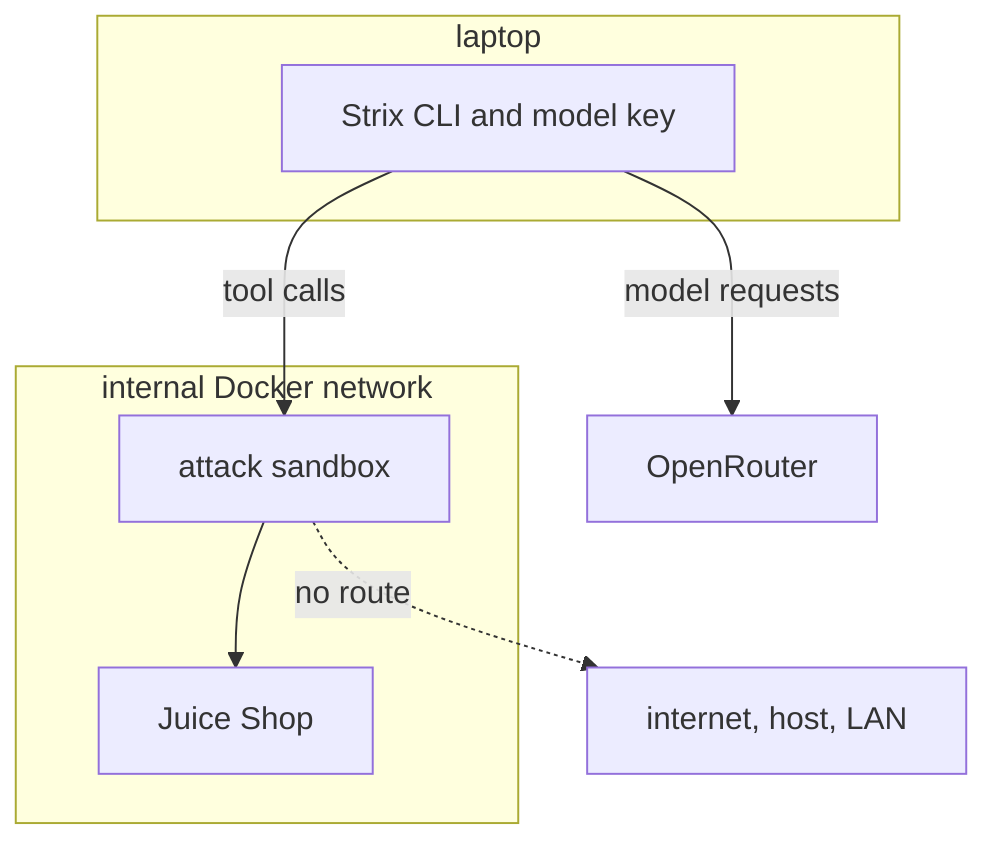

export const meta = {
  title: 'An agent pentests Juice Shop: 25 findings for $0.68, checked',
  lede: 'One saved run of an open-source pentest agent against a deliberately vulnerable app: what it found, how much of it holds up against its own evidence, what it missed, and what kept it on target.',
  date: '2026-11-18',
  tags: ['ai-security', 'pentest', 'appsec', 'agents'],
  refs: ['gh:usestrix/strix', 'gh:bkimminich/juice-shop'],
}

import * as ex from '@/content/exercises'

On November 12 I pointed Strix, an open-source pentest agent, at OWASP Juice Shop running in a container on my laptop. Juice Shop is a deliberately vulnerable training app, so the question was never whether there were bugs to find; it was how good the agent's findings are when you check them against its own evidence.

Everything below comes from the saved run folder: the run record, the 25 finding files, the coverage file, a second-pass verification summary, and the agents' stored transcripts. There are no payloads, credentials or challenge solutions in this post. Juice Shop is a game other people are still playing, and none of the details would make the point any clearer.

## The setup

[Strix](https://github.com/usestrix/strix) is an agentic pentest tool. You give it a target; a root agent plans, hands work to specialist agents, and each one runs real tools in a Docker sandbox and files findings with evidence. I ran version 1.7.0 through a small wrapper script in brick, my lab harness. The wrapper starts Juice Shop, fences the network (more on that below), and caps the run.

| | |
|---|---|
| Target | OWASP Juice Shop 20.4.0-SNAPSHOT, one local container |
| Mode | `quick`, headless, black box, no source code, no credentials given |
| Model | DeepSeek v4.1 Flash through OpenRouter |
| Caps | $5 budget and a 40-turn limit, the wrapper's defaults |
| Duration | 31 minutes 15 seconds |
| Agents | a root agent and 11 specialists, plus a dedupe pass |
| Model requests | 427 |
| Tool calls | 530 |
| Tokens | 36.0 million, 33.0 million of them cached input |
| Cost | $0.68 |

Two notes on those numbers. The 427 is requests to the model, not HTTP requests to the app; the tool calls are where the app got hit, and one tool call is often a script that sends many requests. And the cost is low because of caching: 91% of all tokens were cached input, re-read on every turn at a fraction of the price. Output was 449 thousand tokens, over half of it reasoning.

## What it found

The run filed 25 findings: 2 critical, 6 high, 16 medium, 1 low. Those are the tool's own ratings. Grouped by class (the grouping is mine):

| Class (findings) | Severity | What was wrong |
|---|---|---|
| Login and sessions (7) | 2 critical, 1 high, 3 medium, 1 low | Token verification that does not pin an algorithm, a default admin password, password hashes carried inside tokens, tokens that never expire, a reset flow and a password change that ask for too little, a captcha that hands out its own answer |
| Access control (6) | 2 high, 4 medium | Routes that check you are logged in and never check who you are: the user directory, other people's baskets and complaints, product writes. Two more accept fields the client should never set, such as a role at sign-up |
| Data exposure (6) | 2 high, 4 medium | An open file directory with backups in it, a filename check that can be sidestepped, and API responses that return whole user rows, hashes included |
| Injection (2) | 1 high, 1 medium | A search query built by gluing user text into SQL, and an update that accepts a query operator where it expected an id |
| Business logic (2) | 2 medium | A negative quantity accepted all the way through checkout, and a paid upgrade granted when the payment fields are left out |
| XSS (1) | 1 medium | Cross-site scripting: a search page that writes the query into the page as HTML, with no content security policy behind it |
| SSRF (1) | 1 medium | Server-side request forgery: a profile-picture-by-URL feature that fetches whatever address it is given, loopback included |

The pattern behind most of the list is one sentence from the run's own report: authorization is not enforced in one place, the server trusts what the token says, and sensitive fields are returned by default. That is an accurate reading of this app.

## How good were the findings

The ratings above are the tool's. What follows is what the saved files support.

### The saved verifier pass

After the run, a second pass with a stronger model (an Opus model, per the summary file) read every finding adversarially, in two rounds. It was static: it read the evidence and the proof-of-concept scripts and judged them. It did not run anything.

| Verdict | Count |
|---|---|
| Real | 18 |
| Needs reproduction | 7 |
| False positive | 0 |
| Duplicate | 0 |
| Evidence strong, partial, weak | 12, 12, 1 |
| Proof script not runnable | 3 |
| Good enough to submit | 11 |

So 11 of 25 would survive as written, and 7 would go back for another look. One of those 7 is one of the two criticals, the token-verification bypass. Another is the high-severity product-write finding. The verifier did not say they are wrong. It said the written evidence does not carry the claim on its own.

### The evidence against the raw transcripts

A finding's evidence section is text the model wrote. It could be a faithful copy of what the tools returned, or it could be a confident summary of something that never happened. Strix keeps every agent message and tool result in a small database in the run folder, so this can be checked.

For this post, a script pulled the distinctive values out of each finding's evidence (hashes, byte counts, order ids, totals) and looked for them in the raw tool outputs. 21 of the 25 findings contained values like that, and all 21 had matches. Of 56 values, 53 appeared in raw tool output. The 3 that did not were two email addresses the agent had shortened and one line total it had reformatted. The other four findings had nothing distinctive enough to match mechanically.

That shows the evidence was not invented. It does not show that each bug is exploitable as described, or that the severity is right. Nothing was re-run against a live app for this post. The verifier read the files. A script matched those values to the transcripts. I did not replay the attacks.

Other things the files show:

- **Four findings have no transcript at all.** The negative quantity, the product write, the role at sign-up and the unpaid upgrade are described in prose: "returned status 200 with". All four came from the same agent. Three of them are the ones whose scripts the verifier judged not runnable.
- **Fourteen more use shortened transcripts**, with placeholders where tokens were and `...` where output was cut. That is sensible for a report, but it means the transcripts are retyped, not captured.
- **No finding links to a stored request and response.** The report says every issue is documented with "the exact HTTP request/response transcripts". What is there is the model's own retelling of them.

### Duplicates and overlap

No finding was filed twice. The coverage file shows why: four times, an agent rediscovered something another agent had already filed, said so, and did not file it again. That part worked.

Overlap by root cause is a different question, and by my reading four pairs share one:

- password hashes inside tokens, and password hashes in a public photo feed: both are "the whole user row gets serialized";
- tokens that never expire, and a password change that leaves old tokens valid;
- a login with no rate limit, and a reset flow with no rate limit;
- the open file directory, and the filename check on the same directory.

So 25 findings is closer to 21 things to fix. A human triaging this would merge them. A bug bounty program would too, and pay once.

### Weak findings and severity

Nothing in the list looks like a plain false positive to me. Three look inflated:

- **Reviewer email addresses on product reviews**, rated medium. The finding's own counter-evidence section says reviews are public by design. I would file that as informational.
- **An open metrics endpoint**, rated medium. The finding says it exposes no credentials and no personal data. It is real, and it is low.
- **A public configuration endpoint**, rated medium. Part of it is a client id that is public by design. The verifier wanted this one reproduced.

The ratings also do not sort the way a person would sort them. The SQL injection that returns every stored credential is rated high, 7.5. A default admin password is rated critical, 9.8. Three unrelated data exposures all got exactly 5.3. The agent scored each finding by formula and on its own; nobody ranked the list as a whole.

### Where the report disagrees with the data

The written report is fluent and confident, and in three places it says more than the run's own files do:

1. It says every confirmed issue "was reproduced with a working proof of concept". The verifier found 3 scripts that would not run and 7 findings that need reproduction.
2. It lists open redirects as ruled out. The coverage file's own gap list says the opposite: no coverage entry was recorded for that class, "treat it as unexamined, not as clean". The transcript shows a single probe with a single address.
3. One coverage entry cites the wrong finding number for the captcha issue.

None of these is serious on its own. Together they are the reason to read the data files and not just the report.

## What it missed

Juice Shop's [companion guide](https://pwning.owasp-juice.shop/companion-guide/latest/part1/categories.html) lists 16 challenge categories. Mapping the run onto those categories is my judgment, not something the files state. I did not compare against the individual challenges.

Classes with no finding and no real test:

- **XML external entities.** No coverage entry. The upload feature was left as "needs follow-up" after one attempt.
- **Insecure deserialization.** No coverage entry.
- **Vulnerable components.** The agent downloaded a backup of the app's dependency list, and no coverage entry assesses what is in it.
- **Unvalidated redirects.** One probe, then written up as ruled out.

Classes it touched and probably under-reported:

- **Stored cross-site scripting.** Eight coverage entries rule it out on different inputs, each with a reason. Juice Shop's cross-site scripting category is not only the one search page, so some of those eight are likely misses. In at least one, the agent's notes considered a different input than the one it went on to test. That is inference from the transcript; I have not reproduced it.
- **Cryptography.** Unsalted MD5 password hashes are mentioned inside other findings and in the recommendations, but never filed as a finding.

And things it looked for and could not finish, which it recorded honestly as gaps: server-side code execution (three follow-up entries), a content-security-policy bypass it knew existed and could not locate, and the chatbot, whose model backend was not running in this setup.

That last list is the most useful output of the run. The coverage file has 63 entries: 35 reported, 16 ruled out, 5 with no issue found, 5 needing follow-up, 2 not applicable, plus 7 named gaps. A scanner gives you findings. This gives you findings and a list of what was not tested, and the second list is the one a human can act on.

## An open-book test

Two things in the transcripts make this run easier than a real one.

First, the model knows Juice Shop. Before any crawling, the root agent's brief to its recon agent names two dozen Juice Shop API routes as "key known surfaces". That came from training data, not from the target.

Second, Juice Shop publishes its own challenge list, with descriptions and hints, through an API. 15 of the agents' tool calls touch it, and they used it as a map. One finding quotes a challenge description as supporting evidence.

A real target offers neither. This run measures how well the agent executes against a target it has effectively read about, not how well it discovers.

## Keeping the agent on target

The safety problem with this kind of tool is simple to state: what stops the agent from testing something that is not the target?

In Strix 1.7.0 the answer is the prompt. The source at commit `ef5d8100` has no host allowlist, and `--target` sets where the agent starts. The scope prompt calls the target list "the starting scope, not a ceiling" and tells the agent never to refuse a target the user names. Meanwhile the attack sandbox starts with outbound internet access, a route to the host machine, and raw network capabilities, because scanning tools need them. On a laptop that can reach other machines, a prompt is not enough between an autonomous agent and everything else on the network.

There is one real control: the environment variable `STRIX_DOCKER_SANDBOX_NETWORK`, which puts the sandbox on a Docker network you choose. The wrapper script uses it by default:

- The network is created with Docker's `--internal` flag, so nothing on it has a route out.
- Juice Shop runs on that network and is addressed by container name. Using `localhost` would have handed the sandbox a route to the host.
- The model key stays on the host. The Strix process calls the model; the sandbox only runs tools. So fencing the sandbox does not break the agent.
- There is no wall-clock limit in Strix, so the hard stops are the budget cap and the turn cap.
- Telemetry is off.

The run's own output shows the fence held: the agent's attempts to make the app fetch outside addresses went nowhere, and it logged that as a limit of the environment. It also cost something. One of the gaps above exists because a step needed the internet.

Two limits. The scope file in the range is a record of the engagement, not an enforcement mechanism; Strix does not read it, and it still lists `localhost:3000` where the fenced run used the container name. And the harness's fuller design (a target allowlist the orchestrator enforces, a kill switch, an audit table) is a spec. For this run the controls were the network fence, the two caps, and Ctrl-C.

## Fix one yourself

The plainest bug on the list was finding 13: any logged-in customer could read and change any other customer's basket, because the handler checked for a session and never checked whose basket it was. The agent proved it well, with a control request, a write, and a read-back from the owner's side.

Here is that bug in miniature. The starter fails its tests; fix it so they pass.

<Playground {...ex.basketOwner} />

The same fix, one comparison between the object's owner and the caller, closes most of the access control row in the table above. The lasting version is to put that comparison where every route goes through it, so a new route cannot forget.

## What I take from the run

Half an hour and $0.68 covered seven classes, and the better findings did the thing a scanner usually skips. The agent registered its own accounts and compared what each could see. Several findings show the request that should fail, then the one that should not, and a few put the data back afterwards. The coverage file also says what was not tested. That second list is the one I can act on.

A person still has to do four things this run did not finish. Decide what the agent may touch, and enforce it somewhere other than the prompt. Check a finding before calling it one: 7 of 25 needed reproduction, one of them a critical. Merge the overlaps and rank the list, because 25 is about 21 things to fix and the scores were each computed alone. And read "ruled out" as "not found". The misses sit in that column, and this target was one the model had already read about.

If I were looking at someone else's run, I would ask four questions. What enforces scope besides the prompt? Can I see the raw tool output, not only the write-up? Does anything re-run a finding before it reaches me? Where is the list of what was not tested?

## How far this one run goes

Not past what it is.

- One run. A second one could file a different set, and I have no second run.
- Quick mode, the tool's shallowest setting, with a turn cap. Some gaps say "within budget" for a reason.
- One cheap model. A stronger one might find more, or invent less. This run cannot say.
- One famous target. Every bug in Juice Shop is documented. Zero false positives here says little about a codebase nobody has written up.
- The verifier read the evidence and did not run it. Its 18 "real" verdicts are another model's judgment. No finding in this post has been reproduced by a person. The only mechanical check is the script that matched values to the transcripts.
- The $0.68 is the run alone. The verifier used a more expensive model, and that cost is not in the run record.

So I read it the way I read the red-team lab. The counts describe this saved run of Strix 1.7.0 on DeepSeek v4.1 Flash against Juice Shop. The part that carries over is structural: the evidence mostly matches the tool log, the written report is more confident than those files, and the only control that held the agent on target was the Docker network, not the prompt.
