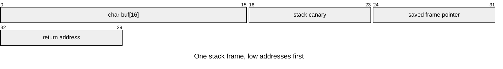
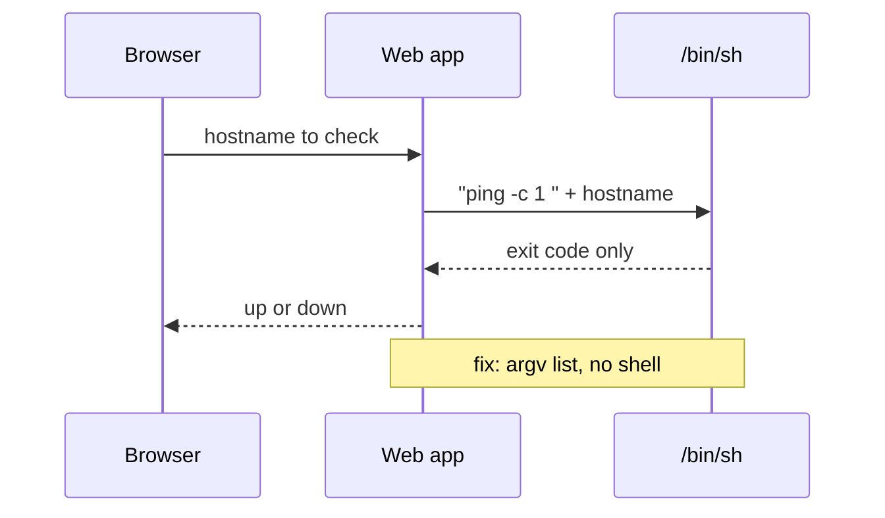
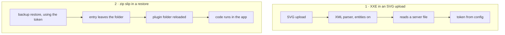
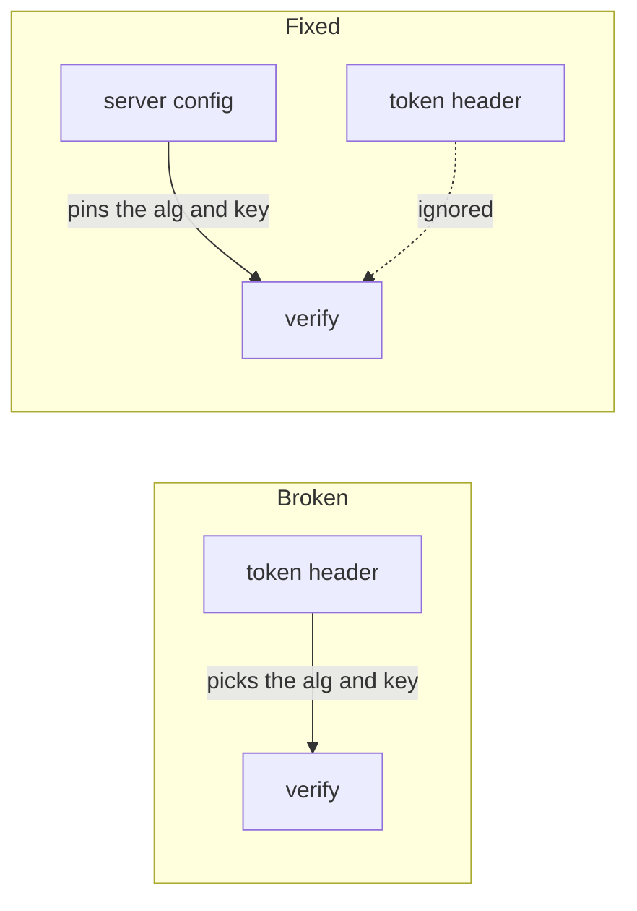
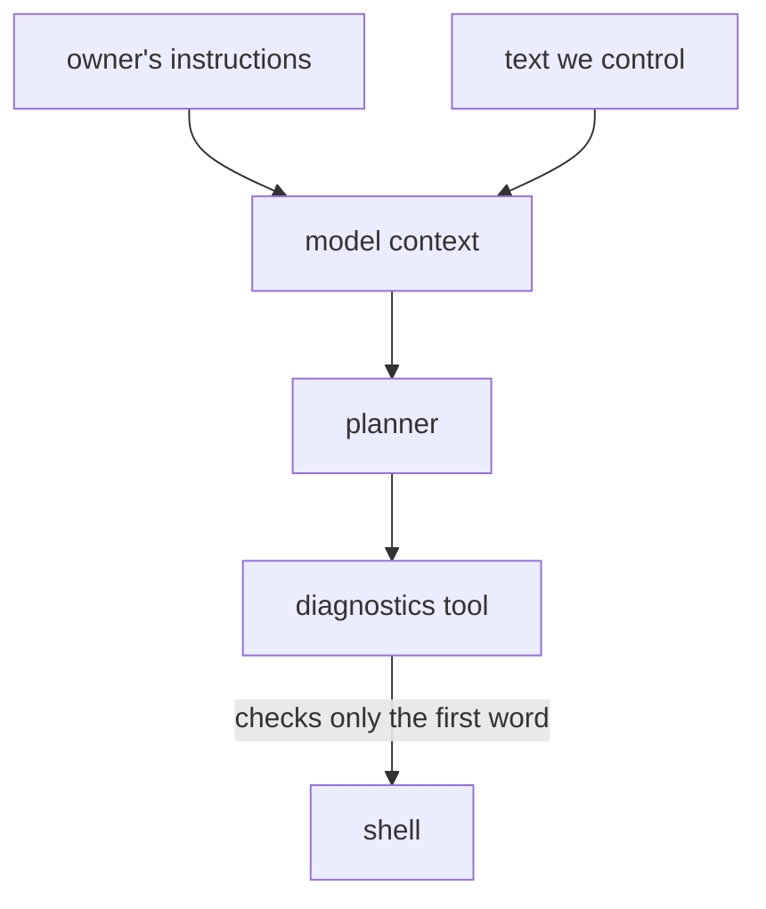

export const meta = {
  title: 'Cyber Trials 2026: five rooms and the bugs behind them',
  lede: "Five rooms from TryHackMe's Cyber Trials 2026. The bug, why it was there, and the fix. No flags.",
  date: '2026-11-17',
  tags: ['ctf', 'tryhackme', 'appsec', 'pwn', 'ai-security'],
}

import * as ex from '@/content/exercises'

On November 13 my team played TryHackMe's Cyber Trials 2026 from brick: one process, one SQLite file, eight seats, a live board. I finished as a Cyber Trials Completionist. No flags and no exploit steps. The rooms may still be live. Each section is the bug, why it was there, and the fix, plus a diagram and a small exercise that runs in the browser.

## The Forge: three ways memory goes wrong

The Forge was three binary exploitation challenges against small Linux programs listening on the network. Each one read input carelessly, and each one had a different set of defenses turned on.

- **The Forbidden Rune** was a classic stack overflow. The program had a function that printed the flag, but nothing ever called it. With no stack canary and no address randomization (no PIE), overflowing a buffer let us redirect the program's return into that function.
- **Borrowed Steel** had no such function, so we had to borrow code from the C library the program already loaded. That technique is called ret2libc.
- **The Silenced Forge** added a seccomp filter that blocked running a shell at all. The way through was to use only the system calls the filter still allowed: open, read and write.

All three come down to the same picture. A function's local buffer sits on the stack just below the values that decide where the program goes next:

**How to find it:** run `checksec` on the binary to see which protections are off. Then read how it takes input: `gets`, `scanf("%s")`, `strcpy`, or a `read` longer than its buffer. A fuzzer like AFL++, or just a very long input that crashes the program, confirms it. **To check the fix,** run `checksec` and the fuzzer again: the protections should show as on, and the same input should no longer crash it.

**The fix:** use bounded reads, and compile with stack canaries, PIE and full RELRO. Seccomp helped in the third challenge, but it only limited what an attacker could do, not whether they got in. Defenses stack; none of them replaces reading input safely.

**Try it:** this copy loop is the bug in miniature, on a 40-byte frame laid out like the diagram. Run it to watch a long input spill into the canary and return address, then fix it.

<Playground {...ex.forge} />

## The Ashen Frontier: one blind command becomes a foothold

The Ashen Frontier was a full box: get a user, then get root. Its web app had a status feature that took a hostname and checked it. It passed that input to a shell, so it could run other commands too. The app only reported whether the command succeeded, not its output, which made it a *blind* command injection. We turned that one bit of feedback into a working channel, got a foothold, moved to a real user over SSH, and reached root through a `sudo` rule that allowed a tool able to run other programs.

**How to find it:** look for any feature that hands input to a system tool, like ping, nslookup or a file converter. In code, grep for `system(`, `exec(`, `shell=True` and backticks. When the app shows no output, time is the tell: if adding a short `sleep` to the input slows the response by that much, the input reached a shell. For the root step, `sudo -l` lists what a user may run as root, and GTFOBins says which of those can start a shell. **To check the fix,** repeat the timing test, which should show no delay, and confirm `sudo -l` lists nothing that GTFOBins knows.

**The fix:** never build shell commands from user input; call the program directly with arguments. And review `sudo` rules against GTFOBins: plenty of everyday tools, like `find`, `vim` and `less`, can run a shell.

**Try it:** the second layer is checking the input. Turn this blocklist into an allowlist.

<Playground {...ex.ashen} />

## The War Camp: an upload chain

The War Camp was a ledger app with file uploads, and it fell to two bugs in a row.

1. **XXE in an SVG upload.** SVG is XML, and the server parsed uploaded SVGs with external entities enabled. An image upload became a way to read files off the server, including a config file with a token in it.
2. **Zip slip in a backup restore.** The restore feature extracted archives without checking entry paths, so a path like `../` could write outside the restore folder. Combined with a plugin directory that the app reloaded on request, a file write became code running inside the app.

**How to find it:** list every place the server parses a file someone uploaded. SVG is XML, and so are DOCX and XLSX inside. For each XML parser, check whether external entities are on; OWASP's XXE Prevention Cheat Sheet names the setting for each language. For archives, find the extract call and check whether it compares each entry's resolved path with the target folder. A test archive holding an entry named `../marker.txt` shows it: if the file lands outside the folder, the extractor is vulnerable. **To check the fix,** upload the same archive and an SVG with a harmless external entity again: the server should refuse both.

**The fix:** turn off external entities and DTDs in every XML parser (or never parse untrusted SVG on the server at all). Resolve every archive entry path and refuse any that leaves the target folder. Don't let a web request reload code from a writable directory.

**Try it:** write the check the restore feature was missing.

<Playground {...ex.warCamp} />

## The King's Seal: trusting the token to describe itself

The King's Seal was a JWT challenge in three stages. The app published a description of how it verified tokens, and the verifier trusted the token's own header too much: which key to use, and what kind of key it was. Once the server lets the token choose its own key or algorithm, a forged token can pass as a real one, and from there we could impersonate a privileged user.

**How to find it:** decode a token (jwt.io or `jwt_tool`) and read its header. If it names a key (`jwk`, `jku` or `kid`), or the server accepts more than one algorithm, test whether the server trusts it: change the header and see whether the token still passes. In code, look for a verify call that doesn't pin its algorithms. **To check the fix,** send the same edited tokens again: every one should be rejected, and the verify call should name one algorithm and one key source.

**The fix:** pin the algorithm and the key on the server, and never let the token's header choose either. Fetch keys only from your own trusted set (JWKS), never from a URL or key embedded in the token.

**Try it:** a toy verifier with the same mistake. Make the server decide.

<Playground {...ex.kingsSeal} />

## The Binding Circle: an AI agent that hurts itself

The Binding Circle was an AI agent with a few tools and a planner that refused anything dangerous. Two weaknesses made the refusal useless:

1. **It couldn't tell its owner's instructions from ours.** Text that we controlled ended up in its context, and it followed it. That's indirect prompt injection.
2. **A tool checked only the start of its input.** A diagnostics tool approved commands by their first word, so anything chained after an approved command ran too.

**How to find it:** map every place text you don't control reaches the model, like web pages, files, emails and tool output. Plant a harmless instruction in one, such as asking the agent to say a canary word, and see whether it obeys. Then read each tool's validation: if it checks only a prefix or a first word, try a separator like `;`, `&&` or a newline after an allowed command. garak and promptfoo automate the prompt side. **To check the fix,** rerun the same canary and separators. The model may still be fooled, but the tool should refuse.

**The fix:** treat everything a model reads as data, never as instructions, and enforce rules in the tools, not in the prompt. A tool should validate its whole input against a strict allowlist, because the model can always be talked into calling it.

**Try it:** here's the tool's check. Make it hold the line no matter what the model sends.

<Playground {...ex.bindingCircle} />

I rebuilt this room on the site. Press `~` and type `familiar`. [The familiar](/blog/the-familiar-agent-ctf) has the same two weaknesses.
