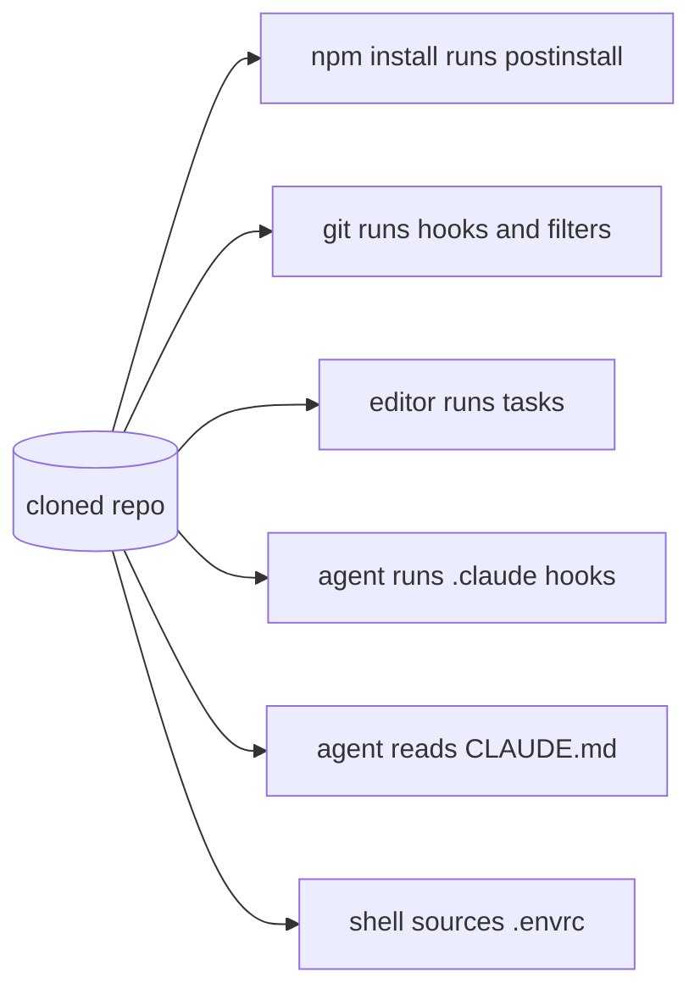
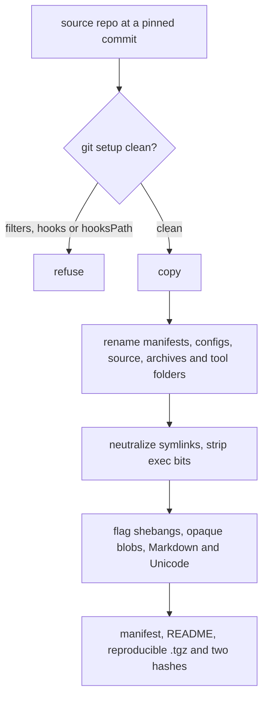

export const meta = {
  title: 'Defanging Shai-Hulud: keeping a worm you never run',
  lede: 'A bash script that renames a Shai-Hulud checkout so install hooks, editors and agents cannot run it, and leaves the bytes unchanged.',
  date: '2026-11-17',
  tags: ['malware', 'supply-chain', 'ai-security', 'bash'],
}

import * as ex from '@/content/exercises'

In May the source of the Shai-Hulud worm showed up on GitHub. It spread through npm packages, and later waves hooked the routines coding agents run when they start, so nobody had to execute it on purpose. I wanted a copy before the repo came down. Opening it is the risky part, so I wrote `defang-specimen.sh` first: one bash script, about 1,500 lines, that makes a copy nothing runs by accident.

## What runs when you open a repo

A dev repo can run itself without a double-click:

- **Package managers run install scripts.** One `npm install` in the wrong folder runs whatever `postinstall` says.
- **Git runs hooks and filters.** A `.gitattributes` filter or a hook runs code on checkout, commit or diff.
- **Editors run tasks.** A `.vscode` folder or a `.code-workspace` file can define tasks and settings that run when you open the folder.
- **Coding agents run hooks.** A repo's `.claude/settings.json` can define hooks: commands Claude Code runs at moments like the start of a session. Later Shai-Hulud waves committed exactly that to the repos they infected, along with a VS Code task set to run when the folder opens, so opening an infected repo in either tool ran the worm again. No `npm install` needed.
- **Coding agents read instructions.** `CLAUDE.md`, `.mcp.json`, `claude_desktop_config.json` and plain Markdown are read by agents as instructions. An agent asked to "help me read this repo" can be told to do something else entirely.
- **Shells read dotfiles.** `.envrc`, `.bashrc` and friends run the moment a tool sources them.

The copy has to shut each of those and still be readable byte for byte.

## Rename, don't modify

The core rule is to change file *names*, never file *contents*. Every script, manifest, config and agent file gets a suffix, so `package.json` becomes `package.json.AUDIT-SPECIMEN.txt`. Nothing recognizes it anymore: npm doesn't see a package, git doesn't see a hook, an editor doesn't see a workspace, and an agent doesn't see a config. But the bytes are untouched, so the analysis is still of the real thing.

It runs as a pipeline over a copy. The original is never modified. The phases:

- **Manifests and configs**, over 100 name patterns across npm, Bun, Deno, Python, Rust, Go, Ruby, Java, Docker, CI and agent tooling, renamed and kept.
- **Source and executables**, from `.js` and `.sh` to `.ps1`, `.lnk`, `.hta`, Office macro formats, `.jar`, disk images and `.apk`, renamed.
- **Archives** renamed to `.AUDIT-SPECIMEN-ARCHIVE.txt` and never extracted.
- **Folders that tools act on**, like `.git`, `.github`, `.vscode`, `.husky`, `node_modules` and build output, renamed but kept, because shipped build artifacts can be the payload.
- **Agent folders and instruction files.** Config folders for coding agents (`.claude`, `.cursor`, `.gemini`, `.codex`, `.kiro`, `.windsurf` and others) are renamed whole, and so are instruction files like `CLAUDE.md`, `AGENTS.md`, `GEMINI.md` and `.cursorrules`.
- **Symlinks neutralized**, special files stripped, and executable bits removed.
- **Shebang lines found and flagged**, so a renamed file that still starts with `#!` stands out.
- **Opaque blobs detected** with an entropy check, so a packed or encrypted payload hiding as a `.txt` gets flagged.
- **Other Markdown flagged** as possible agent instructions.
- **Unicode flagged.** Non-ASCII file names are reported, and names are normalized to catch two files that look identical but aren't.

In order, the run looks like this:

The opaque-blob check is the least obvious one, and it fits in a dozen lines. Shannon entropy measures how random a file's bytes look; packed or encrypted payloads score near the maximum.

<Playground {...ex.entropy} />

## The rules the script holds itself to

The script states these at the top and treats a violation as a bug:

1. The specimen is never executed. Its bytes are only read by `sha256sum`, a small entropy helper, `rsync`, `tar` and `gzip`.
2. Specimen content is never printed to the terminal. Even file names are hex-escaped before they are logged, so a crafted name can't inject escape sequences into my terminal.
3. Every `find` uses `-print0` and every `read` uses `-d ''`, so a file name with a newline in it can't split into two.
4. No `eval`, no `source`, no unquoted expansion, and `printf '%s\n'` only.
5. Every destructive path is guarded with `${var:?}`, and every temp file lives under `mktemp -d`, removed on exit.
6. It refuses to run as root.

Rule 2 is easy to get wrong, so here it is as an exercise. Make `safeName` escape a name the way the script does before it logs one.

<Playground {...ex.safeName} />

Before it touches anything, it checks the repo's own git setup: it refuses any `.gitattributes` filter, any hook beyond git's samples, and any `core.hooksPath`.

## What comes out

The output is the defanged tree, a manifest of every rename, drop and flag, and a README that explains what was done. It's packed into a byte-reproducible `.tgz` with two hashes, one for the inner tar and one for the archive. Anyone who runs the same version on the same commit gets the same hashes, so the copy can be verified years from now. The commit itself is pinned up front: the script takes the source commit's hash as a required argument and refuses to start if it doesn't match.

## A gap I closed later

Version 2.0.1 (November 2026) closed a gap in 2.0.0. The original renamed every file inside `.claude/`, including the `settings.json` the later waves use for their hook, but it left the `.claude/` folder itself, the files in agent folders it didn't know, and instruction files like `AGENTS.md` and `GEMINI.md` under their working names. It only flagged Markdown. Version 2.0.1 renames all of them, matches names regardless of case (so `.Claude/` on a Mac counts), and adds `binding.gyp` and Python `.pth` files, which a later wave used to run code at install and at startup. It also fixes a bug that made 2.0.0 stop partway through on any specimen with a `.txt` file inside a folder it had already renamed, such as `node_modules`.

## What it isn't

It is not a sandbox. It stops an install, a hook, an editor task, or an agent reading the wrong file. It does not make the code safe to run. The read still happens in a VM with no credentials. The copy is what I can grep, and what I can hand an agent, without those tools turning it back into the worm.
