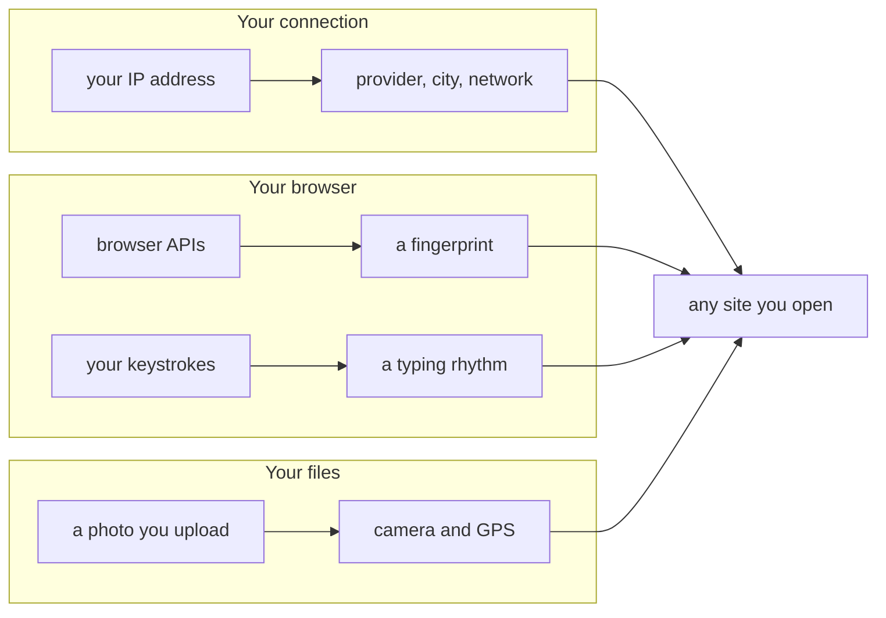
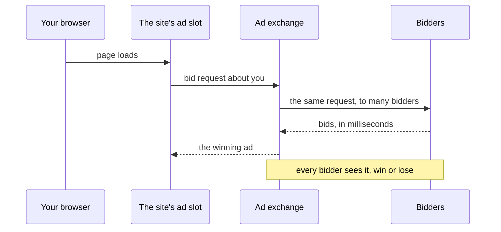
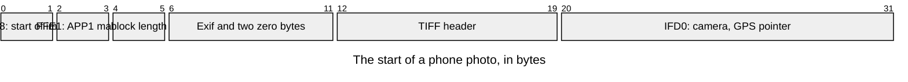
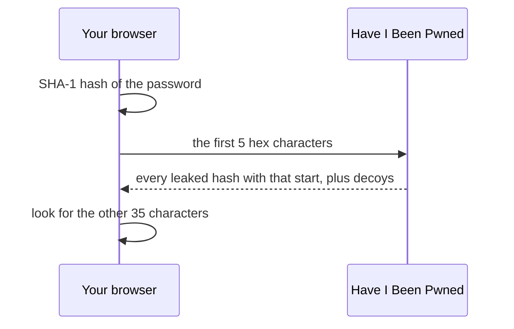

export const meta = {
  title: 'How this site sees you, and so does every other one',
  lede: "A tour of /you: what your connection, your browser, your typing, your photos and your passwords give away to any site, how each one is measured, and what blunts it.",
  date: '2026-11-17',
  tags: ['privacy', 'osint', 'fingerprinting', 'web'],
}

import * as ex from '@/content/exercises'

This site has a page called [/you](/you). It shows you what any website can learn about you without asking: no cookie, no login, no permission prompt. I built it because most people have never seen the list, and the people who profit from it would prefer they didn't.

The page stores nothing, and this site runs no analytics. Everything below is measured either from the request your browser already made, or by code in your browser that keeps the result there. This post explains how each check works, so you can judge it for yourself, and each section ends with what actually helps.

Four kinds of things leak, and they reach a site in different ways:

## Your connection

Before a single line of JavaScript runs, the server knows your IP address, because it's where the reply goes. This site runs on Cloudflare, which hands every request a lookup of that address: the network provider that owns it (its ASN and name), a city, region and postal code from a GeoIP database, a map point at the center of that area, the nearest Cloudflare data center, and how many milliseconds away you are. The [/you](/you) page asks the server what it saw and shows you the same list.

Then it checks whether the pieces agree, the way fraud and streaming sites do to spot a VPN:

- **Clock against IP.** Your browser reports its time zone. If your IP says Amsterdam and your clock says Chicago, you're probably on a VPN, and the clock says where you really are.
- **Language against IP.** A browser asking for `en-US` pages from a German IP is another mismatch.
- **Who owns the address.** IPs owned by hosting companies and VPN providers are easy to recognize, and many sites flag them.
- **WebRTC.** The page asks Cloudflare's STUN server what address it sees. Some VPNs only tunnel ordinary web traffic, so this answer can be your real IP, leaking past the tunnel.

**What helps:** a VPN that also tunnels WebRTC, or a browser that turns WebRTC off. Set your clock and language to match where your VPN says you are, or accept that a careful site will notice. Tor Browser handles all of this for you.

## Your fingerprint

The second part runs in your browser. It reads fourteen values that any page can read without asking: your user agent and client hints, languages, time zone, screen size, CPU cores, GPU model, which fonts are installed, how your machine draws a test picture on a canvas, how its audio stack processes a test tone, your keyboard layout, your storage quota and your display preferences. Each one is common on its own. Together they're often unique, and the page hashes them into one short fingerprint.

The math is why this works. If one browser in eight shares your value for some signal, that signal carries three bits of information about you. Identifying one person among 8 billion takes about 33 bits, and every signal you leak adds a few. Here's the arithmetic, with made-up shares for the example:

<Playground {...ex.fingerprintBits} />

Real signals overlap (a Mac usually has a Mac's fonts), so you can't simply add them, but it doesn't take many. The page has a test you can run yourself: open it in a private window and compare the fingerprint. If it matches, a site can recognize you even after you clear your cookies.

**What helps:** blending in, not hiding. A rare setting makes you easier to spot, and that includes turning on privacy signals few people use. Tor Browser makes everyone look the same; Brave and Firefox's `resistFingerprinting` add noise or report standard values. A fingerprint that changes on every reload is a good sign.

## The ad auction

Most ads aren't placed in advance. When a page with an ad slot loads, an auction runs in about a tenth of a second, and the request that starts it describes you to every bidder. The [/you](/you) page builds that request, an OpenRTB 2.6 `BidRequest` (the industry's standard format), filled with your real values, and shows it to you instead of sending it.

The request carries your IP, the GeoIP location, your device and browser down to the build, the page you're on, and an ID for your browser. Only one bidder wins, but every bidder receives the request, and that's the part worth understanding: a single page view can send your details to many companies you've never heard of.

**What helps:** an ad and tracker blocker such as uBlock Origin blocks most ad scripts, so most of these auctions never start. Global Privacy Control asks sites not to sell your data, and it's legally binding in some US states.

## Your typing

The way you type is a signature. Anti-fraud scripts on banking and login pages time each key: how long you hold it (dwell) and the gap between releasing one key and pressing the next (flight). Your averages and their spread stay stable enough to tell you from someone who stole your password. The [/you](/you) page measures yours while you type one sentence. Here's the core of that measurement:

<Playground {...ex.typing} />

**What helps:** not much, and this one is mostly used for you, not against you. Password managers that fill fields in one go give a page no rhythm to measure. Just know it's there whenever a site watches a text field.

## Your photos

A phone photo carries more than the picture. A JPEG starts with a block called APP1 that holds EXIF metadata: the camera make and model, the software, when it was taken, sometimes the lens and serial number, and very often the GPS position where you were standing.

The [/you](/you) page reads those bytes in your browser (the file is never uploaded) and shows you what's there, with a link to the spot on a map. It then hands you a clean copy, made by drawing the picture onto a canvas and saving that, which carries no metadata at all.

**What helps:** many big platforms strip EXIF when you upload, but email attachments, file shares, forums and "send original" in chat apps often keep it. Turn off location in your camera app, or strip photos before you send them.

## Your passwords

The last check tells you whether a password has shown up in a known breach, without ever sending the password. It uses Have I Been Pwned's range API, which works by k-anonymity:

Hundreds of leaked hashes share any 5-character start, so the service learns almost nothing about which one is yours, and the decoys hide even how many there are. The matching happens in your browser:

<Playground {...ex.pwned} />

**What helps:** if a password you use shows up, change it everywhere you've used it. A password manager makes every password unique, so one breach can't unlock the rest.

## Why show any of this

None of this is secret to the people who use it. Ad exchanges, data brokers and anti-fraud vendors read these signals all day, on almost every site. The only person usually left out is you.
