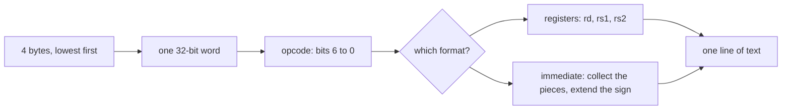

export const meta = {
  title: 'Reading RISC-V by hand: finishing a disassembler from 2023',
  lede: 'How one 32-bit word turns back into an instruction, the three bugs a hand-written decoder runs into, and a disassembler you can run on this page.',
  date: '2026-11-18',
  tags: ['reversing', 'risc-v', 'javascript', 'c++'],
}

import * as ex from '@/content/exercises'

In 2023 I wrote a small C++ program that reads RISC-V machine code and prints the instructions it finds. It was coursework-era code, about 200 lines, and it still carries a comment that says `//work in progress`. The [repo is still public](https://github.com/thecandylane/RISC-V_Disassembler). The tool further down this page is its JavaScript port, finished: it covers the whole RV32I base set, and it fixes the bugs the original has.

This post walks through how the decoding works, where the original went wrong, and how to check a decoder like this against one you can trust.

## Why a disassembler comes first

A disassembler turns the bytes of a program back into the instructions a processor would run. I think it's the first reversing tool worth writing yourself, for three reasons.

- **Everything else is built on it.** A debugger, an emulator and a decompiler all start by decoding instructions. If you understand that step, the tools above it stop being magic.
- **It makes you read the spec.** You can't guess an encoding. You have to open the manual and find out which bit means what, and that habit carries over to file formats and network protocols.
- **It's easy to check.** One word goes in and one line of text comes out. Somebody else's disassembler can tell you whether your line is right.

RISC-V is a good place to start. In the base set every instruction is exactly 32 bits, and there are only 40 of them. An x86 instruction can be anywhere from 1 to 15 bytes long, so you have to decode one just to find where the next one begins.

## One word, split into fields

Take the word `0x00a00513`. Written out in bits and cut at the right places, it reads:

```text
000000001010  00000  000  01010  0010011
imm = 10      rs1    f3   rd     opcode
              zero        a0     0x13
```

The lowest seven bits are the **opcode**, and `0x13` means arithmetic with an immediate, which is a number stored inside the instruction itself. The three `funct3` bits pick which arithmetic, and `000` is `addi`. `rd` is the register that receives the result and `rs1` is the register that is read. Registers are five bits each because there are 32 of them. Register 10 is called `a0` and register 0 is `zero`. So the word says `addi a0, zero, 10`: put 10 in `a0`.

Every word goes through the same steps:



## The six formats

The opcode tells you which of six layouts the other 25 bits use:

```text
 31          25 24   20 19   15 14    12 11          7 6      0
+--------------+-------+-------+--------+-------------+--------+
|    funct7    |  rs2  |  rs1  | funct3 |      rd     | opcode |  R
|      imm[11:0]       |  rs1  | funct3 |      rd     | opcode |  I
|  imm[11:5]   |  rs2  |  rs1  | funct3 |   imm[4:0]  | opcode |  S
| imm[12|10:5] |  rs2  |  rs1  | funct3 | imm[4:1|11] | opcode |  B
|               imm[31:12]              |      rd     | opcode |  U
|         imm[20|10:1|11|19:12]         |      rd     | opcode |  J
```

| Format | Used by | Example |
|---|---|---|
| R | register arithmetic | `add a0, a1, a2` |
| I | arithmetic with an immediate, loads, `jalr` | `lw ra, 12(sp)` |
| S | stores | `sw ra, 12(sp)` |
| B | conditional branches | `beq a0, a1, 0x108` |
| U | `lui` and `auipc`, which carry 20 upper bits | `lui t0, 0x12345` |
| J | `jal` | `jal ra, 0x108` |

The labels inside the boxes say which bits of the *immediate* each piece holds. In S, B and J those pieces are out of order, and that looks like a mistake until you read why. The RISC-V manual gives three reasons:

- **The registers never move.** `rd`, `rs1` and `rs2` sit at the same bit positions in every format, so the hardware can start reading registers before it knows which instruction it has. A store has no `rd`, so its immediate is split around `rs2` and takes the `rd` slot.
- **The sign is always bit 31.** Every immediate is signed, and its top bit is always the top bit of the word. Sign extension can start at once.
- **B and J reuse the wiring.** Branch offsets are always even, so bit 0 is never stored. Instead of shifting the whole field left by one, B keeps bits 10 to 1 where S has them and puts bit 11 in the slot that held S's bit 0. J's pieces are placed the same way, to line up with U and I.

The layout is cheap for a chip and awkward for a person. A decoder in software has to put the pieces back in order, and that's where the bugs are.

## Three bugs a hand-written decoder hits

### Sign extension

A 12-bit immediate of `0xffc` means -4. If you copy the 12 bits into a 32-bit integer and stop, you get 4092. The original has this bug. Its load case does:

```cpp
imm = (instruction >> 20) & 0XFFF;
```

`instruction` is unsigned, so `lw a0, -4(s0)` would come out with an offset of 4092. The fix is to shift a *signed* value, because a signed right shift copies the sign bit down as it goes. In C++ that is `(int32_t)instruction >> 20`. In JavaScript `>>` is the signed shift and `>>>` is the unsigned one, and picking the wrong one is the same bug:

```js
const immI = (w) => w >> 20;   // -4
const oops = (w) => w >>> 20;  // 4092
```

### Putting B and J back together

The B immediate is four pieces and the J immediate is four more. Getting one piece wrong gives a decoder that works on most branches. The original's B line puts word bit 7 into offset bit 0, where it belongs in bit 11, and it never extends the sign, so every backward branch looks like a long forward one. Short forward branches still decode correctly, which is how a bug like this survives.

Here is that line, moved to JavaScript. Fix it until every test passes:

<Playground {...ex.branchOffset} />

The C++ also has two `switch` cases that run on into the next one because they have no `break`. Following the code, a `lw` is printed as `SLTI` and every branch is printed as `JAL`.

### Byte order

RISC-V stores instructions least significant byte first. The word `0x00a00513` is the bytes `13 05 a0 00` in a file. Read them in the other order and you get `0x1305a000`, which is not an instruction at all. There is a quick check for this: every 32-bit RISC-V instruction ends in the bits `11`, so the first byte of each word in a file should have its two lowest bits set.

The original gets this one right. It builds each word a byte at a time with `instruction |= byte << (j * 8)`.

## Checking against a decoder you trust

The original repo ships one test file, `test_instructions.bin`. It holds six instructions: a `nop`, an `addi`, an `add`, a `sub`, a `jalr` and a `jal`. None of them is a load, a store or a branch, and none has a negative immediate. That file could not have caught any of the bugs above.

Two things make a better test.

**Choose the hard inputs on purpose.** For every immediate, test a negative value, the largest value, the smallest value, and a value that sets only the odd piece: +2048 for a branch, which lives in word bit 7 alone.

**Compare with an existing disassembler.** LLVM's `llvm-mc` decodes bytes from standard input, and `-M no-aliases` makes it print the plain instruction where it would otherwise print a shorthand like `li`:

```sh
$ echo '0x13 0x05 0xa0 0x00' | llvm-mc --disassemble -triple=riscv32 -M no-aliases
	addi	a0, zero, 10
```

It also works the other way, as an assembler, with `-show-encoding`. Every expected line in the port's tests was assembled that way (LLVM 23.1.4), and the opcode and `funct3` values were read against the tables in [riscv-opcodes](https://github.com/riscv/riscv-opcodes), the RISC-V project's machine-readable opcode tables.

The port was then run against `llvm-mc` on 250,000 words, most of them random bits under a valid opcode. On the 112,199 words the port decodes, the two printed the same instruction for all but 331. Every one of those is an `ori` that writes to `zero`, which this LLVM prints as a prefetch hint from a later extension. In a sample of 2,500 words the port leaves as `.word`, LLVM decoded only control register instructions and `fence.i`, which the port leaves out on purpose.

## The tool

Paste 32-bit hex words, with or without `0x`, or open a `.bin` file. Each line shows the address, the word, the format letter and the instruction. Branch and jump targets are printed as addresses, counted from 0. It runs in your browser and nothing is sent anywhere. The last sample is the 2023 test file.

<RiscvDisasm />

The same tool is on the [Lab](/lab) page.

## What it covers

The port decodes all 40 RV32I instructions, plus the eight multiply and divide instructions of the M extension, because the original had started on `MUL` and `DIV`. It prints plain instructions and never shorthands, so a return shows up as `jalr zero, 0(ra)` and not `ret`. It doesn't know the 16-bit compressed instructions, the control register instructions or the 64-bit ones. A word it doesn't know is printed as `.word` with its hex value, so you can always see what was skipped.

The original covers register arithmetic, loads, immediate arithmetic, stores, branches and `JAL`, and it prints register numbers where the port prints names. It was a first pass at the problem, and its mistakes are a fair map of the parts of the encoding that are easy to get wrong.
