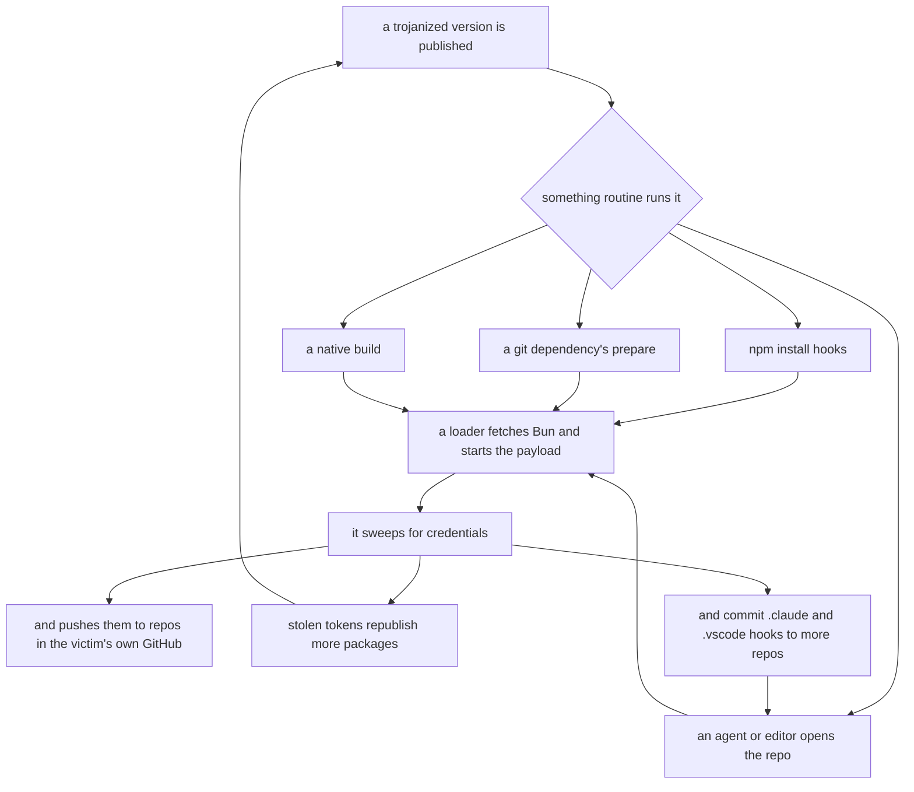

export const meta = {
  title: 'Shai-Hulud: ten waves, one shape',
  lede: 'Ten Shai-Hulud waves, September 2025 to October 2026. The payload changed. The loop did not: install, sweep, GitHub, republish.',
  date: '2026-11-17',
  tags: ['malware', 'supply-chain', 'npm', 'detection'],
}

After [defanging a copy](/blog/defanging-shai-hulud), I read the public reports: Wiz, Unit 42, Datadog, StepSecurity, Socket, Sonatype, OX, JFrog, Endor Labs, Sygnia, and CISA. It is at least ten waves over thirteen months. Each rewrote the payload. Five other attacks used the same moves. Structure only: what runs, what it reads, where the data goes. No payload code. Two tools at the end check a package or a repo for that shape.

## Ten waves

| Wave | First seen | How it got in | What ran it |
|---|---|---|---|
| Shai-Hulud | Sep 2025 | stolen npm tokens | `postinstall` |
| Sha1-Hulud: The Second Coming | Nov 2025 | stolen tokens, some mined from CI secrets | `preinstall`, then Bun |
| Shai-Hulud 3.0 | Dec 2025 | one maintainer account | install hook |
| The Third Coming (Bitwarden CLI) | Apr 2026 | a compromised release path | `preinstall` plus a `bin` shim |
| Mini Shai-Hulud (SAP) | Apr 2026 | the publish path for four SAP packages | `preinstall` |
| Mini Shai-Hulud (TanStack, then Nx Console) | May 2026 | a poisoned CI cache, then a publish token taken from the runner's memory | a git dependency's `prepare` hook |
| Here We Go Again (AntV) | May 2026 | one maintainer account | `preinstall` or a git dependency's `prepare` |
| Miasma (Red Hat, AsyncAPI) | Jun 2026 | account takeovers | `binding.gyp`, import time, Python `.pth` files |
| ChainDrop and Tensorlake | Aug to Oct 2026 | maintainer accounts and the projects' own release workflows | `preinstall` |
| An MCP Registry offshoot | Aug 2026 | a registry entry pointing at a poisoned repo | opening the repo in an editor or agent |

Sources disagree on some details: how the first wave got its tokens, exactly when the SAP wave began, and most of the package counts. Where they disagree, I left the detail out.

## One shape

Strip the version-specific details and every wave runs the same loop:

- **The way in is a trusted name.** The waves shipped as new versions of real packages, published with a real maintainer's token, account or CI identity. No typo-squatting needed.
- **The sweep barely changes.** Environment variables, `.npmrc`, the `gh` token, cloud credentials and instance metadata, SSH keys, `.env` files. Later waves added secrets read straight out of CI runner memory, browser-saved passwords, and AI tool configs like `~/.claude.json` and MCP settings.
- **The data mostly goes to GitHub, under the victim's own name.** New public repos with a marker in the description, or commits used as dead drops. To a network monitor, it looks like an ordinary developer pushing to GitHub.
- **It spreads with what it stole.** An npm token republishes every package that token can publish, with a patch bump, so anyone on a caret range picks it up on their next install.

## The trigger kept moving

Each wave used a different trigger:

1. `postinstall`, the obvious one (September 2025).
2. `preinstall`, which runs earlier and installs Bun, a runtime most projects never use (November 2025).
3. A `bin` shim that runs when the package's command is called (April 2026).
4. A git dependency pinned to a commit, whose own `prepare` hook does the work, so the trojanized package's `package.json` has no install script at all (May 2026).
5. `binding.gyp`, which makes npm run a native build with no script in `package.json`, and Python `.pth` files, which run when Python starts (June 2026).
6. No install at all: a Claude Code `SessionStart` hook in `.claude/settings.json` and a VS Code task set to run on folder open, committed into every repo the stolen GitHub token could reach (from April 2026 on). Opening the repo in either tool runs the worm.

From April 2026, opening the repo was enough. That is why [defang-specimen.sh](/blog/defanging-shai-hulud) renames `.claude` and `.vscode`, not only `package.json`.

## What other attacks share

Five other npm and JavaScript attacks from the same period, compared on the same structures: the Nx "s1ngularity" compromise (Aug 2025), the chalk and debug maintainer compromise (Sep 2025), GlassWorm in VS Code-compatible extensions (Oct 2025 on), SANDWORM_MODE (Feb 2026) and the axios compromise (Mar 2026).

| Structure | Families out of 6 |
|---|---|
| A hijacked trusted publisher (account, token or CI identity) | 6 |
| Code that runs on a routine developer action | 6 |
| A sweep for developer and CI credentials | 5 |
| An obfuscated payload whose size or shape breaks from the last version | 5 |
| GitHub used for exfiltration, dead drops and spreading | 4 |
| Self-propagation through publishing | 3 |
| Agent or editor config as a way to run code or as loot | 3 to 4 |

The agent angle differs by family. Shai-Hulud uses agent hooks, which run commands without any AI involved. SANDWORM_MODE adds a rogue MCP server and hides instructions in its tool descriptions, which is real prompt injection. s1ngularity ran the victim's own AI coding CLIs to search the disk for secrets.

## Catching it before it installs

The payload rotates every wave, so signatures on payload bytes keep going stale. What stays stable is the manifest diff between a clean version and an infected one. Every Shai-Hulud wave changed at least one of these:

- a new or changed install hook (`preinstall`, `install`, `postinstall`)
- a new native build (`binding.gyp`)
- a dependency that now comes from git or a URL
- a new command added to your `PATH`
- a different publishing account, or build provenance that disappeared
- a jump in size, usually one huge new file at the root

This checks a live package for exactly that, against the version before it. It reads public npm metadata in your browser and installs nothing.

<NpmDiff />

Two limits. The TanStack wave had valid build provenance, because it stole the CI identity provenance vouches for. A new package has no previous version to diff. Several waves were flagged by scanners within hours of publishing.

## Catching it in a repo

For the hooks committed into repos, the files themselves are the signal. These YARA-X rules match the structure the later waves left behind, not any payload bytes: an install hook that starts Bun or a loose loader script, a Claude Code `SessionStart` hook, a VS Code folder-open task, and a git dependency pinned to a commit. It runs VirusTotal's real engine, compiled to WebAssembly, in your browser.

<YaraPlayground />

A `SessionStart` hook isn't malicious by itself, plenty of teams use them, so treat a hit as "read this before opening the repo", not a verdict. The tell is a hook or task that showed up in a commit from an account or bot that doesn't normally touch those files.

## If you're hit, order matters

Several 2026 waves installed a monitor that watches for the stolen token being revoked and wipes the home directory when it is. Sources disagree on whether the GitHub or the npm token is the trigger. Either way, the usual instinct, revoking every token immediately, can set it off. Find and remove the persistence first (a background service, a self-hosted runner registered on the machine, new hooks in `.claude/` and `.vscode/`), then rotate everything the machine could reach.

## Sources

- CISA, [Widespread supply chain compromise impacting the npm ecosystem](https://www.cisa.gov/news-events/alerts/2025/09/23/widespread-supply-chain-compromise-impacting-npm-ecosystem) (September 2025)
- Wiz on [the first wave](https://www.wiz.io/blog/shai-hulud-npm-supply-chain-attack) and [Shai-Hulud 2.0](https://www.wiz.io/blog/shai-hulud-2-0-ongoing-supply-chain-attack)
- Unit 42, [the npm attack](https://unit42.paloaltonetworks.com/npm-supply-chain-attack/) and [the npm threat landscape](https://unit42.paloaltonetworks.com/monitoring-npm-supply-chain-attacks/)
- Datadog Security Labs, [Shai-Hulud 2.0](https://securitylabs.datadoghq.com/articles/shai-hulud-2.0-npm-worm/)
- StepSecurity on [@ctrl/tinycolor](https://www.stepsecurity.io/blog/ctrl-tinycolor-and-40-npm-packages-compromised), [TanStack](https://www.stepsecurity.io/blog/mini-shai-hulud-is-back-a-self-spreading-supply-chain-attack-hits-the-npm-ecosystem) and [AntV](https://www.stepsecurity.io/blog/shai-hulud-here-we-go-again-mass-npm-supply-chain-attack-hits-the-antv-ecosystem)
- TanStack's own [postmortem](https://tanstack.com/blog/npm-supply-chain-compromise-postmortem)
- Wiz on [the SAP wave](https://www.wiz.io/blog/mini-shai-hulud-supply-chain-sap-npm), Sonatype on [Miasma](https://www.sonatype.com/blog/new-shai-hulud-miasma-wave-hits-hundreds-of-npm-packages), Sygnia on [keyv](https://www.sygnia.co/threat-reports-and-advisories/shai-hulud-returns-software-supply-chain-attack-npm-keyv/), OX on [the MCP offshoot](https://www.ox.security/blog/shai-hulud-outbreak-debrief-the-worm-evolves-into-mcp/)
- For comparison: Wiz on [s1ngularity](https://www.wiz.io/blog/s1ngularity-supply-chain-attack), Aikido on [chalk and debug](https://www.aikido.dev/blog/npm-debug-and-chalk-packages-compromised), Socket on [SANDWORM_MODE](https://socket.dev/blog/sandworm-mode-npm-worm-ai-toolchain-poisoning)
