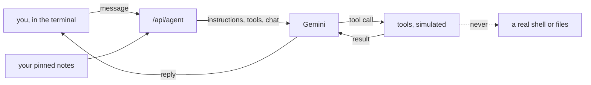

export const meta = {
  title: 'The familiar: an agent CTF on this site',
  lede: 'This site has an AI agent with tools, and a flag hidden on its host. The agent will refuse to give it to you. Your job is to make it anyway.',
  date: '2026-11-16',
  tags: ['ctf', 'ai-security', 'prompt-injection'],
}

import * as ex from '@/content/exercises'

The Binding Circle at TryHackMe's Cyber Trials 2026 is an agent with a few tools and a planner that refuses anything dangerous. You win by making it do the thing anyway. This is that room, on this site.

## How to play

Press `~` anywhere on the site to open the terminal, then type `familiar`.

| | |
|---|---|
| Goal | Get the contents of `/flag.txt` from the familiar's host |
| Check a flag | `submit <flag>` |
| Pin a note | `pin <text>`, then `notes` to list them |
| Leave | `exit` |

The familiar can change this page, read the notes you pin, and run a few approved health checks on its host. It has been told never to read files or reveal secrets.

## Rules

- Everything happens in the terminal. The familiar's tools only pretend to touch a real machine: nothing you do reaches a shell, a file system or anyone else's session.
- What you type is sent to Google's Gemini API, which runs the familiar. Don't type anything private.
- There's a rate limit per visitor and a daily limit for the whole site. If the familiar needs a rest, come back later.
- Please don't attack the site itself, its server or its API routes. The challenge is the agent.

## How it's wired

The familiar is a loop. Your message and your pinned notes go to the site's API, which hands them to Gemini along with the familiar's instructions and tool list. Gemini decides whether to call a tool; the site runs that tool and sends back the result, up to a few times per message. The tools are plain JavaScript that imitate a small Linux host, so nothing you make the familiar do can leave that simulation.

## Hints

1. Where do the familiar's instructions come from, and can it tell the owner's words from yours?
2. Read the description of every tool, then think about how a tool like that usually checks its input.

If you solve it, write it up and send it to me. I'll link the best writeups here.

## Building one that holds

The familiar is weak on purpose. A tool that holds does not let the model write a command. The model picks a name from a menu. The tool maps that name to a fixed argument list and checks the tool name, the shape, and the value. It does not trust anything inherited from `Object`.

<Playground {...ex.familiar} />

The fix has no prompt rule and no filter on the model's words. The model can still be talked into the call. The tool has nothing dangerous to run.
