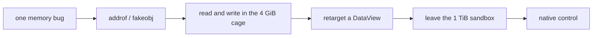

export const meta = {
  title: 'Three bugs, one model',
  lede: 'Three V8 bugs from 2026, the chain from a memory bug to code execution, and which steps the Forge can reproduce.',
  date: '2026-11-17',
  tags: ['javascript', 'v8', 'exploitation', 'ctf'],
  refs: ['gh:v8/v8', 'gh:bellard/quickjs'],
}

In August 2026 Depthfirst reported three bugs in V8 and turned two of them into v8CTF flags. Their [writeup](https://depthfirst.com/research/from-javascript-to-renderer-code-execution-three-v8-vulnerabilities-and-two-v8ctf-flags) is the map. A memory-corruption bug is half the chain. The other half is leaving a sandbox built to contain it.

## The three bugs

| Bug | Class | Root cause |
|---|---|---|
| CVE-2026-78938 | type confusion | TurboFan built `Promise.prototype.finally`'s helpers as non-strict and constructable. `new` on such a helper returns a number, which the compiler had typed as an object |
| CVE-2026-79236 | stale storage | Load elimination kept an object's property array across a map check that was allowed to migrate the object and replace that array |
| issue 546253900 | sandbox escape | Wasm memory serialization registered one backing store and handed the worker a different one, leaving a dangling `Isolate*` outside the V8 heap sandbox |

The first two are compiler bugs. The third is not a memory bug. Two mechanisms that both look correct disagree about which buffer is shared.

## The chain

Every modern chain looks like this, whatever the entry bug is:

The V8 sandbox reserves a terabyte and constrains how objects inside it refer to memory. Pointer compression then keeps ordinary references inside a 4 GiB cage within that reservation. So a corrupted JS heap buys you cage access, and cage access buys you nothing until you find an object with a native pointer you can retarget — in the Depthfirst chain, a `DataView`, and later a Wasm backing store.

Shared Wasm memory keeps a list of the isolates using it, as native pointers outside the sandbox. Serializing it registers a backing store. Registration follows an extension handle. Delivery follows the object identity. The worker ends up attached to a buffer nobody registered. When the worker dies, its native isolate is freed and the buffer still points at it. `memory.grow(0)` calls into freed memory. The reclaim is a queued WebSocket message sized to the same `0x20000` allocation. The exploit checks that the payload landed on the dangling address before triggering it.

Each step limits what the next step can assume.

## What a model can carry

The Forge is a JavaScript engine small enough to read, with one deliberate bug:

- values are 32-bit tagged words, a Smi in the low bit and a cage offset in the high bits;
- objects have a 16-byte header and 4-byte slots;
- doubles do not fit in a slot, so they live in their own HeapNumbers, exactly as V8 does it;
- the allocator only ever moves forward, and the sweep never moves anything, so a stale offset stays readable.

The sweep never moves a block, so a stale offset still reads the next allocation instead of crashing.

## What it cannot carry

The Forge has no JIT, so no bug in it is a compiler bug. It has no pointer compression, so its cage is 64 KiB rather than 4 GiB. Its sandbox is a handle table in the host, not a terabyte reservation. And it has no native memory at all — the last step of a real chain simply does not exist there.

That is the difference between this model and a browser. What it does have: the bugs are in the engine's own paths, an ordinary program can reach them, and the checks read memory and the host log, not the exploit source.

The Forge is at [/forge](/forge). It runs on the server, for reasons the next post gets into.
