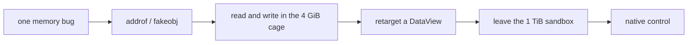

export const meta = {
  title: 'Three bugs, one model',
  lede: 'Chrome needed two separate bugs for one code execution this year. Here is the chain, and what a small engine can honestly reproduce of it.',
  date: '2026-11-17',
  tags: ['javascript', 'v8', 'exploitation', 'ctf'],
  refs: ['gh:v8/v8', 'gh:bellard/quickjs'],
}

In August 2026, Depthfirst reported three bugs in V8 and turned two of them into v8CTF flags. Their [writeup](https://depthfirst.com/research/from-javascript-to-renderer-code-execution-three-v8-vulnerabilities-and-two-v8ctf-flags) is the clearest map I have found of what exploiting a JavaScript engine means now. The short version: a memory corruption bug is half a chain, and the other half is getting out of a sandbox built specifically to contain you.

## The three bugs

| Bug | Class | Root cause |
|---|---|---|
| CVE-2026-78938 | type confusion | TurboFan built `Promise.prototype.finally`'s helpers as non-strict and constructable. `new` on such a helper returns a number, which the compiler had typed as an object |
| CVE-2026-79236 | stale storage | Load elimination kept an object's property array across a map check that was allowed to migrate the object and replace that array |
| issue 546253900 | sandbox escape | Wasm memory serialization registered one backing store and handed the worker a different one, leaving a dangling `Isolate*` outside the V8 heap sandbox |

The first two are ordinary compiler mistakes with a nasty shape. The third is the interesting one, because it is not a memory bug at all. It is a disagreement: two mechanisms that both look correct, taught to believe different things about which buffer is being shared.

## The chain

Every modern chain looks like this, whatever the entry bug is:

The V8 sandbox reserves a terabyte and constrains how objects inside it refer to memory. Pointer compression then keeps ordinary references inside a 4 GiB cage within that reservation. So a corrupted JS heap buys you cage access, and cage access buys you nothing until you find an object with a native pointer you can retarget — in the Depthfirst chain, a `DataView`, and later a Wasm backing store.

Their escape is worth reading twice. Shared Wasm memory keeps a list of the isolates using it, as native pointers outside the sandbox. Serializing it registers a backing store, but the registration follows an extension handle while delivery follows the object identity, so the worker ends up attached to a buffer nobody registered. When the worker dies, its native isolate is freed while the buffer still points at it. `memory.grow(0)` then calls into freed memory. The reclaim uses a queued WebSocket message sized to the same `0x20000` allocation, and the exploit checks that the payload landed on the dangling address before triggering it.

Nothing in that chain is a trick you can bolt on at the end. Each step narrows what the next step may assume.

## What a model can carry

I wanted a place to teach the *shape* without pretending to ship a browser exploit. So the Forge runs a JavaScript engine small enough to read, with one deliberate bug in it:

- values are 32-bit tagged words, a Smi in the low bit and a cage offset in the high bits;
- objects have a 16-byte header and 4-byte slots;
- doubles do not fit in a slot, so they live in their own HeapNumbers, exactly as V8 does it;
- the allocator only ever moves forward, and the sweep never moves anything, so a stale offset stays readable.

That last property is the point. A use-after-free that crashes teaches nothing; one that reads the next allocation teaches everything.

## What it cannot carry

The Forge has no JIT, so no bug in it is a compiler bug. It has no pointer compression, so its cage is 64 KiB rather than 4 GiB. Its sandbox is a handle table in the host, not a terabyte reservation. And it has no native memory at all — the last step of a real chain simply does not exist there.

Those are not small omissions. They are the difference between a model and a browser. What the model does have is the part people get wrong when they read writeups: the bugs are in the engine's own code paths, reachable by ordinary programs, and the checks are made against memory and host state rather than against what the exploit source looks like.

The Forge is at [/forge](/forge). It runs on the server, for reasons the next post gets into.
