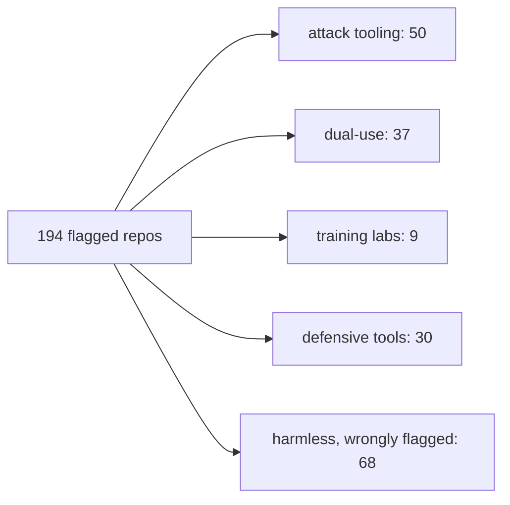

export const meta = {
  title: 'What 194 flagged repos look like',
  lede: "ref-radar marks some repos \"dangerous code: read, don't run\". I had an agent read every one of them: what's really in there, the shapes that repeat, the repos built to fool AI agents, and where my own scanner gets it wrong.",
  date: '2026-11-17',
  tags: ['ref-radar', 'malware', 'ai-security', 'detection'],
}

import * as ex from '@/content/exercises'

[ref-radar](https://ref.lookit.space) is my catalog of reference repos for coding agents. Before a repo goes live, a scanner checks it, and anything that looks risky gets a flag: "dangerous code: read, don't run". On November 17 there were 194 flagged repos. I wanted to know two things: what's actually behind those flags, and how often my scanner is right.

So I had an agent read all 194, using only ref-radar's own read tools: file trees, manifests, outlines, text search and file reads. Nothing was cloned, built or run, and files the scanner holds back as possible traps stayed unread. The agent wrote down structure only (file layout, APIs, the order things happen in), never payloads.

## What's in there

The attack tooling is what you'd expect from a security catalog: command-and-control frameworks, Active Directory and Entra ID attack kits, wireless and radio tools, web exploit collections, cloud and container tooling, and a new group, AI agents that run penetration tests. Dual-use covers things like scanners and recon tools that defenders use as much as attackers.

What's missing matters too. There are no worms, no credential stealers and no malware loaders. ref-radar keeps live malware out of the catalog and quarantines any repo that carries a known worm's files, and that held. Among the repos the agent read, the stealer's core move, sweeping up credentials and sending them out, showed up exactly once, as a deliberate test case inside a scanner's test suite.

## Shapes that repeat

Payloads differ, but the attack tooling is built from a handful of shapes. Each one is easy to recognize once you know it:

- **One module per technique.** A `modules/` or `plugins/` folder with one file per attack, CVE or target, and a core that loads them by name. 27 repos. It's the most common shape in the attack tooling, across Active Directory, web, wireless, Android and LLM attack kits alike.
- **A server and an implant.** An operator server in one folder and the agent it controls in another, often with several ways to talk (HTTPS, DNS, sometimes a SaaS API used as the channel). 16 repos.
- **Directory enumeration, then credential material.** Read users, groups and certificate templates from Active Directory or Microsoft Graph, find a misconfiguration, then request a token or certificate. 15 repos in the identity family, and a text search found the directory attribute names in 9 of the 10 it checked.
- **Raw radio frames.** Monitor mode, crafted 802.11 frames and rogue access points. 8 repos; 7 of the 8 contain the tell-tale terms.
- **Attack corpora for LLMs.** Collections of jailbreak and injection prompts, or agents that run them. 8 repos.

One shape surprised me by where it lives. A text search found install-time execution (npm `postinstall`, Python `setup.py` hooks, plugin hooks that run at session start) in 13 of the 56 flagged repos it checked, and in none of the 13 attack tools it checked. In this catalog, auto-run hooks belong to ordinary projects that download a prebuilt binary or show a status line. The attack tools make you run them on purpose.

## Repos built to fool agents

Three repos are aimed at the AI agents that read code, on purpose:

- **One poisons reverse-engineering agents.** It plants decoy symbols and poisoned text tuned to mislead one specific AI reverse-engineering tool, and writes its own MCP config and skill into the user's home agent settings.
- **One is a honeypot for attacking agents.** It's HTTP middleware that rewrites pages to carry instructions aimed at any agent browsing them, next to a fake MCP endpoint and decoy credentials.
- **One is a scanner's test fixture.** A skill that looks innocent, whose helper reads environment variables and sends the sensitive-looking ones out. It exists so the scanner has something to catch, and it's the clearest example of the pattern I've seen.

And one ordinary repo, a well-known Active Directory library, ships a `CLAUDE.md` asking agents to run a PowerShell command. It's almost certainly a harmless developer setup step, and the agent reading it correctly ignored it. But it's exactly the shape a trap would take, which is the point: a repo's agent files are input, and an agent has to treat them as data.

That's why "has a `CLAUDE.md`" can't be the signal. 59 of the 194 flagged repos ship agent instruction files, and almost all are normal. What's worth flagging is narrower: an instruction file that names a command to run or a URL to fetch, hidden characters or comments with orders in them, an MCP config pointing at a server the project doesn't own, or code that writes into the user's own agent settings.

## Where my scanner is wrong

About 68 of the 194 flags are wrong: the repos are harmless. Most of the mistakes come from two rules.

**Shellcode bytes.** The rule that looks for raw machine-code byte arrays flagged 39 repos, and 28 of them were harmless: cryptography test vectors, firmware images, font tables, and detection tools' own test data. The 194 also include VirusTotal's own YARA-X and the rizin reverse-engineering framework. When I went to fix the rule, neither turned out to be this rule's doing: YARA-X is flagged for a line in one of its own YARA rules, and rizin's flag is a stale record from an older scan. Bytes alone don't run. Shellcode needs memory it's allowed to execute, so a better rule wants both the byte array and a call that makes memory executable or starts code in another process, and trusts a file under `tests/` or `fixtures/` less:

<Playground {...ex.shellcodeFlag} />

**Agent files.** I first blamed these for dozens of the wrong flags. Checking the rules showed that was wrong: no rule fires on an agent file just for being there, and a test now pins that. The 59 repos that ship them were flagged for something else.

**The trap labels themselves.** Eight repos carry ref-radar's "agent trap" or "compromised" label. On a review of the manifests that wire those files in, all eight look harmless: installers that download a prebuilt binary, plugin hooks that show a status line, a scanner script that carries worm indicators as data, a script nothing calls, and a recorded test fixture. The flagged files are held back from reads, so the review couldn't confirm it, and that's a gap too: the owner needs a way to see a held-back file to clear or confirm the label.

**A bug the review found.** ref-radar's code search is rate-limited to about 20 calls a minute, and over the limit it returned no matches instead of an error. The agent's first round of counts came back wrong for that reason and had to be thrown away. A rate limit should say so.

All of this is filed as issues on ref-radar, along with one repo that should get the `lure` label: a "proof of concept" for a PHP version that never existed, shipping a 46 KB "quick fix" shell script.

## How far to trust this

- Every count is a lower bound. The text search skips very common words, caps how much it returns, and was rate-limited.
- Safety filters stopped the deeper read of the 18 command-and-control and post-exploitation repos, so those are described from their catalog entries, not their code.
- The categories are one agent's reading, checked by me against the summaries. A second reader would draw a few borders differently.

The useful result isn't the exact numbers. It's that a security catalog's flags need context to mean anything. A byte array, a hook or a `CLAUDE.md` is common and almost always fine. What matters is the combination: bytes plus executable memory, a hook plus a download it runs, an instruction file plus a command it wants you to run.
